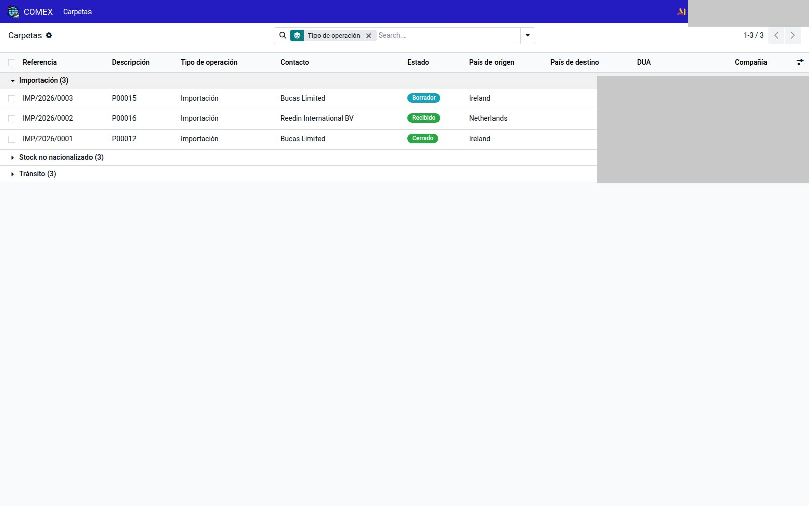
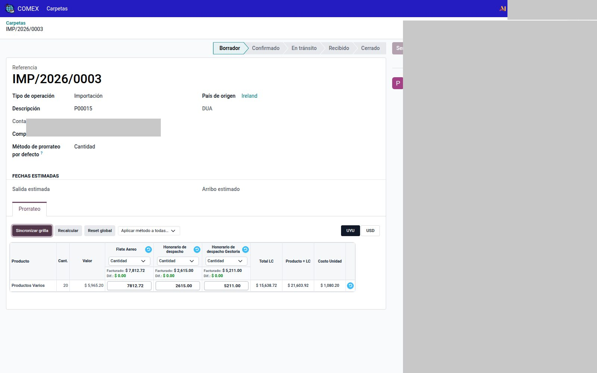
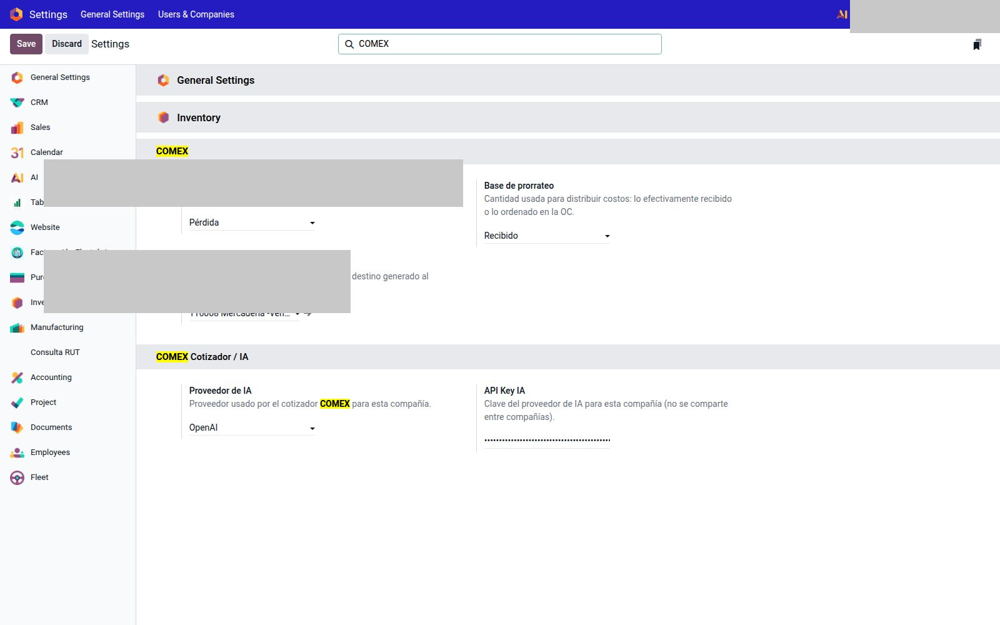

# Carpetas COMEX

Módulo `comex`. Una carpeta = una operación de **importación** o **exportación**.

`Comex → Tablero` es la home. Primero **conteos** (Importaciones, Tránsitos). Después **acumulados** en la **segunda moneda**: Fletes, Otros gastos, Recargos, IVA, Anticipo de IVA, Anticipo de IRAE. El nombre de cada tarjeta se edita en **Configuración → Configuración de tarjetas**. Cada tarjeta desglosa los **últimos seis meses** (columnas y línea, como el tablero de Contabilidad). Si no hay movimiento, las columnas van en 0: no se inventan montos. El título muestra el **porcentaje recibido a tiempo**. Varios productos de la misma tarjeta se suman. Fletes / otros gastos / recargos son productos LC. IVA y anticipos salen de la factura del despachante, aunque la línea no tenga producto y solo diga `I.V.A. IMPORTACION`, `ANTICIPO DE I.V.A.` o `ANTICIPO IRAE`. Clic abre facturas o carpetas. Arriba: Carpetas, Embarques, Cotización. No hay tarjeta NONAC.

`Comex → Embarques` es el kanban de importaciones y tránsitos. La barra superior desglosa a tiempo / tarde / en tránsito / sin fecha pautada. El arribo pautado es la fecha de la carpeta; la recepción es la última picking de entrada validada. El filtro **Embarques activos** no es el estado En curso de la carpeta.

`Comex → Carpetas`.

---

## Crear y avanzar

La carpeta de importación nace de la orden de compra: **Carpeta COMEX** (crear nueva o unirse a una existente). La de exportación, de la orden de venta. Una factura de gasto ya vinculada a una OC se une a esa carpeta. `COMEX → Carpetas` no tiene **Nuevo**.

1. Tipo importación o exportación, descripción, países, fechas estimadas. La importación ya nace **En curso**.
2. DUA con la máscara del país (`COMEX → Configuración → DUA por país`).
3. Exportación: **Confirmar**, **En tránsito**, **Entregado**.
4. Pestaña **Prorrateo**: se puede armar **antes** de recibir mercadería y con facturas de gasto **en borrador**. La cantidad de la grilla es la comprada (OC/OV). **Dif.** de cada costo capitalizable tiene que quedar en 0.
5. **Validar LC** (importación en curso, grupo **Administración COMEX**): facturas **posteadas**, recepción validada, la guía cubierta y los documentos del medio cargados. El prorrateo se rebasea a lo recibido y se genera el costo en destino.
6. Si después llega una factura: **Ajustar**, cargarla, **Aplicar ajuste**. Hace falta que esté posteada y que el prorrateo capitalizable quede en cero. El asiento acredita la cuenta de esa factura por el mismo monto. **Volver a LC validado** sale sin generar el asiento.
7. **Cancelar** una importación solo en curso, y solo si no tiene facturas posteadas. Una exportación, solo en borrador o confirmado. La barra de estado no cambia el estado: se usan los botones.

Estados importación: **En curso** → **LC validado**. **Cancelada** solo desde En curso. Salida, arribo y recepción son fechas y la recepción de inventario, no estados. **Validar LC** genera el costo en destino. Si después llega una factura, **Ajustar** y **Aplicar ajuste**: lo que sigue en stock va a valuación y lo ya vendido se queda en el gasto de esa factura. No se reescribe el costo ya validado. **Volver a LC validado** deja la grilla como estaba al pulsar **Ajustar**. En ajuste no se cambia el incoterm.

Estados exportación: Borrador → Confirmado → En tránsito → Entregado → Cerrado.

---

## Qué se engancha

Una factura de proveedor con costo en destino no se postea sin carpeta (o el check **No pertenece a operación COMEX**).

`COMEX → Facturas sin carpeta` (admin): el pendiente a enganchar. Smart buttons: OC, OV, facturas, recepciones, costo en destino.

Pestaña **Prorrateo**: matriz producto × costo. **Excel** baja esa misma grilla. El rótulo de la columna de mercadería sigue el incoterm de la OC (Valor FOB, Valor CIF, …). Si la factura del proveedor parte flete o seguro, esa columna pasa a llamarse **Valor mercadería**. **Costo en Origen** y los demás gastos van en columnas aparte. Mientras la carpeta está abierta usa **cantidad comprada** y suma facturas en borrador (para ver cuánto hay que desembolsar). El **costo en destino** nativo no se crea hasta **Validar LC**, contra lo posteado y lo recibido.

Si la OC ya tiene carpeta, o el proveedor es de otro país, junto al incoterm se listan los costos mínimos que la carpeta va a pedir. Una compra local con incoterm no muestra ese texto. Es una guía: un costo de más se carga igual.

El pedido es un **concepto** (Flete, Seguro, Gastos locales, Despachante, Impuestos), no un producto fijo. En el producto de costo en destino, el campo **Concepto de la guía COMEX** dice cuál cubre. Una factura con otro producto del mismo concepto alcanza: la columna de fábrica deja de decir **Falta factura**. **Flete y seguro** cubre los dos. El IVA u otro impuesto de la factura no cubre el concepto Impuestos: hace falta una línea de producto.

**Despachante** e **Impuestos** no capitalizan al stock. El resto de la guía sí. Se cambia en el producto, campo **Capitaliza al costo (COMEX)**.

En una factura CIF, CIP o CFR vinculada a la carpeta, Odoo indica cómo cargar el flete y el seguro cuando la factura del proveedor los muestra (en una línea o en dos). Si no aparecen, no se agregan.

Pestaña **Documentos**: al elegir el medio de transporte (marítimo, aéreo, carretera, ferroviario, fluvial) pide el documento de ese medio. Carretera pide CRT y MIC/DTA. Cuando la guía tiene sus facturas y esos archivos están cargados, **Enviar al despachante** abre el correo con esos archivos. No lo manda solo.

En la lista, la columna **Guía** dice qué falta para poder cerrar: facturas de la guía, facturas sin postear, recepción, prorrateo o documentos. **Se puede validar** aparece cuando **Validar LC** ya puede seguir. Si falta un documento, el botón no genera el costo en destino. Una factura en borrador alcanza para la guía y para el mail; no alcanza para esa marca.

La guía y los documentos se ajustan en `COMEX → Configuración`.

`Comex → Configuración → Configuración de tarjetas` cambia el título que se ve en el tablero (por ejemplo Otros gastos). `Comex → Configuración → Productos por tarjeta` asigna cada producto de costo en destino a una tarjeta: Fletes, Otros gastos, Recargos, IVA, Anticipo de IVA, Anticipo de IRAE. El honorario del despachante va en Otros gastos. Impuestos va en Recargos. IVA y los anticipos salen de la factura del despachante y no capitalizan. La lista es por compañía. **Cargar desde la guía** toma los productos LC que ya tienen concepto (flete, gastos locales, honorario, impuestos) y los asigna.

Los productos de gasto LC tienen que facturarse **sobre cantidades pedidas**, no al recibir. Si no, la línea entra en 0 y la grilla muestra Facturado 0. Odoo avisa al postear o vincular esa factura.

Ahí también:

- **Faltante en recepción:** pérdida o backorder, según la compañía.
- **Cuenta puente LC COMEX:** crédito del asiento al validar el LC. Un ajuste posterior acredita la cuenta de la factura, no esta puente.

Al validar el LC, si el período contable está cerrado, Odoo avisa (wizard). Factura duplicada en la misma carpeta: aviso, no se silencia.

No copies la cuenta puente ni el DUA de otra empresa.
