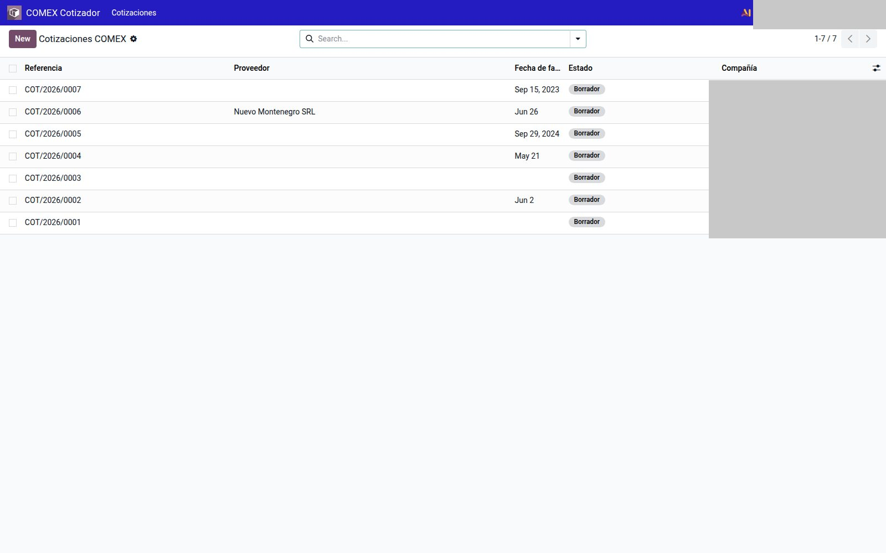

# Cotizador COMEX

Módulo `comex_quote` (en implementación: el circuito de UI ya está; la IA y el catálogo NCM se siguen afinando).

`Comex → Cotización → Cotizaciones`. Catálogo: **Consulta NCM**, agrupado por la **partida de 4 dígitos**; cada grupo se despliega para ver las aperturas. No es una app aparte: vive dentro de Comex.

**Cerrar cotización** deja la cotización histórica y guarda el NCM de cada línea de mercadería. No crea la orden de compra. **Crear OC** aparece después del cierre.

La glosa, la tasa y los documentos son los del país de la compañía. Uruguay muestra la glosa de ocho dígitos y, si el código tiene diez, la hoja nacional. Paraguay muestra la glosa de ocho. La tasa y los documentos de Uruguay no se usan en una compañía paraguaya.

---

## Armar un presupuesto

1. **Nuevo.** Adjuntá la factura comercial (PDF o imagen).
2. **Continuar** — wizard de costos (flete, seguro, gastos origen/terminal/línea, flete importación, honorario, despacho). Una línea tipeada, sin PDF, entra por el mismo wizard: guarda los costos y no extrae. Con PDF, **Procesar** lee la factura y muestra moneda, fecha, incoterm y líneas. El incoterm se toma del término impreso (FOB, CIF u otro) y se puede cambiar hasta que exista la orden. La clasificación sigue en la cotización, una partida por vez: primero el capítulo de 4 dígitos y después la hoja dentro de ese capítulo. Si la similitud del texto apunta a otra partida, la línea queda marcada para revisar.
3. La IA extrae líneas y sugiere NCM. La moneda queda vacía hasta que la factura la trae; después se puede cambiar. Si no hay partner: **Crear proveedor**.
4. Revisá confianza, documentos exigidos y alerta de prohibido (rojo). **Ver exigidos**, al lado de los documentos de la línea, abre el detalle de esa partida: el código y la nota del organismo (decreto o resolución). Si el feed no trae nota, la descripción queda vacía.
5. **Reclasificar NCM (IA)** o clic en la columna **NCM**. El popup muestra la glosa a ancho completo, del capítulo a la hoja, con sangría. **Buscar** consulta el arancel por el significado del texto y recién entonces lista candidatos. Se puede cambiar el texto por una descripción más clara para mejorar la búsqueda. El NCM de la línea no cambia hasta **Confirmar**. En cada candidato, **Documentos exigidos** muestra el detalle y los recargos vigentes (arancel, TGA, IMESI, IVA, tasa consular, anticipos) en el mismo popup, con fondo claro; si no hay tasa vigente no se muestran ceros, se indica que no hay tasa. **Cerrar documentos** vuelve a la lista. En **Consulta NCM** el botón está en la lista y en la ficha. La columna **NCM** muestra el número; si no hay partida, **Buscar**. La columna **Glosa** muestra solo **Ver glosa**. Ese popup recorre desde el título del capítulo hasta la partida y cierra con los porcentajes de arancel, TGA, IMESI, IVA, tasa consular y anticipos. La tasa y los documentos son los del país de la compañía. Uruguay muestra la de ocho dígitos y la hoja nacional de diez. Paraguay muestra la glosa de ocho. La tasa uruguaya no entra en una compañía paraguaya. **Confirmar al catálogo**. El aviso de match de producto se queda en la línea.
6. Con el NCM elegido, cada línea de mercadería muestra la **liquidación orientativa**: valor en aduana, arancel, TGA, IMESI, IVA, tasa consular, anticipos y el total. El valor en aduana es la mercadería más la parte de flete, seguro, gastos en origen y flete de importación. La pestaña **Líneas** abre primero, con la misma tabla compacta, y ahí están la partida, los documentos y los tributos. El menú de columnas de esa tabla incluye todas: descripción genérica, franja de confianza, documentos y cada tributo. Las que ya se veían siguen marcadas. La pestaña **Prorrateo**, a la derecha, muestra la grilla: producto, cantidad, valor y una columna por costo, con total, producto más costos y costo unitario. El método (valor, cantidad, peso o volumen) es uno para todas las columnas. **UYU** y **USD** cambian la moneda en la que se ven esos montos. Si la factura ya trae ese costo como línea, manda la línea; si no, manda la columna del cabezal. Terminal, honorarios y gastos de despacho se ven aparte y no entran en esos tributos.
7. El beneficio es uno solo y arranca en **régimen general** (el arancel de la partida). Si el origen de la mercadería —o, si no está, el país de la factura— es Argentina, Brasil o Paraguay, se puede elegir el **certificado Mercosur**: el arancel queda liberado según el margen DNA. Bolivia, Chile y Venezuela permiten anotar su certificado (ACE 36, ACE 35 o ACE 59). Si la partida de ocho dígitos está en ese acuerdo, el arancel baja según ese margen. Si no está, o los códigos del acuerdo no coinciden, el arancel sigue en régimen general. **Margen ALADI 504** es la otra opción, por país, y no se combina con el certificado. **Liberación** reemplaza a esos dos: en la línea se elige una fila vigente de esa partida (código, porcentajes y fechas; el feed no trae el nombre) y esos porcentajes son exenciones del arancel, la TGA, el IVA y el IMESI. Si las líneas tienen orígenes distintos, la pregunta es por línea. Una factura brasileña de mercadería china no pregunta el certificado. Si la compañía es uruguaya y las monedas están en el feed DNA, se puede usar esa tasa. El dólar está en pesos. Las otras monedas se convierten pasando por ese dólar.

**Cerrar cotización** no crea documentos: la cotización pasa a Cotizado y el NCM de cada línea de mercadería entra al catálogo. Si no se puede calcular el vector, el NCM igual se guarda y las sugerencias no lo usan hasta entonces. **Crear OC** pide confirmar que el proveedor sigue siendo el de la cotización. Si una línea de mercadería no tiene producto, el mismo paso la lista y hay que elegir un producto que ya exista para cada una; el cotizador no crea productos. Sin producto en todas las líneas la orden no se arma. La orden lleva solo las líneas de mercadería y, si hay PDF, el archivo. La factura de proveedor se crea desde la orden, con el flujo nativo de Compras. Crear la orden no enseña el catálogo. El incoterm, si está, se copia a la orden y después no se edita en la cotización. Una cotización cancelada o vencida no se cierra por este botón. La barra de estado no pasa a Convertido sola. La carpeta se crea después, desde la orden. El cartel de la cotización sigue siendo una estimación: el despachante confirma el NCM.

La API key de IA vive en `Ajustes → Inventario → COMEX Cotizador / IA`, **por compañía**. No va a git ni a este sitio.

!!! warning
    La clasificación NCM es asistencia. El despachante confirma la partida. Un NCM prohibido o en conflicto de catálogo se marca en rojo: no lo ignore.
