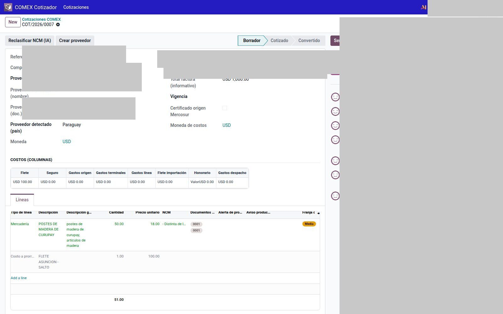
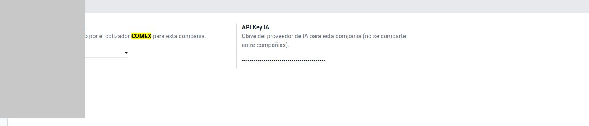

# Cotizador COMEX

Módulo `comex_quote` (en implementación: el circuito de UI ya está; la IA y el catálogo NCM se siguen afinando).

App **COMEX Cotizador → Cotizaciones**. Catálogo: **Consulta NCM**.

Hoy, tras procesar, la cotización **sigue en Borrador**. Cotizado / Convertido existen en el modelo; todavía no hay botones que avancen esos estados.

---

## Armar un presupuesto

1. **Nuevo.** Adjuntá la factura comercial (PDF o imagen).
2. **Continuar** — wizard de costos (flete, seguro, gastos origen/terminal/línea, flete importación, honorario, despacho) y certificado Mercosur si aplica. **Procesar**.
3. La IA extrae líneas y sugiere NCM. Si no hay partner: **Crear proveedor**.
4. Revisá confianza, documentos exigidos y alerta de prohibido (rojo).
5. **Reclasificar NCM (IA)** o **Buscar NCM**. **Confirmar al catálogo**. **Crear producto** si no existe.
6. Con el NCM elegido, cada línea de mercadería muestra la **liquidación orientativa**: valor en aduana, arancel, TGA, IMESI, IVA, tasa consular, anticipos y el total. El valor en aduana es la mercadería más la parte de flete, seguro, gastos en origen y flete de importación. El reparto se elige en **Prorrateo de costos** (valor, cantidad, peso o volumen). Si la factura ya trae ese costo como línea, manda la línea; si no, manda la columna del cabezal. Terminal, honorarios y gastos de despacho se ven aparte y no entran en esos tributos.
7. El beneficio es uno solo y arranca en **régimen general** (el arancel de la partida). Si el origen de la mercadería —o, si no está, el país de la factura— es Argentina, Brasil o Paraguay, se puede elegir el **certificado Mercosur**: el arancel queda liberado según el margen DNA. Bolivia, Chile y Venezuela permiten anotar su certificado (ACE 36, ACE 35 o ACE 59) y el arancel no cambia. **Margen ALADI 504** es la otra opción, por país, y no se combina con el certificado. Si las líneas tienen orígenes distintos, la pregunta es por línea. Una factura brasileña de mercadería china no pregunta el certificado. Si la factura está en dólares, se puede usar la tasa DNA en lugar de la tasa de la compañía. En otra moneda se muestra el número DNA y no se convierte.

No hay (aún) “convertir a carpeta” desde este formulario. El cartel de la cotización lo dice: es una estimación. El despachante confirma el NCM.

La API key de IA vive en `Ajustes → Inventario → COMEX Cotizador / IA`, **por compañía**. No va a git ni a este sitio.

!!! warning
    La clasificación NCM es asistencia. El despachante confirma la partida. Un NCM prohibido o en conflicto de catálogo se marca en rojo: no lo ignore.
