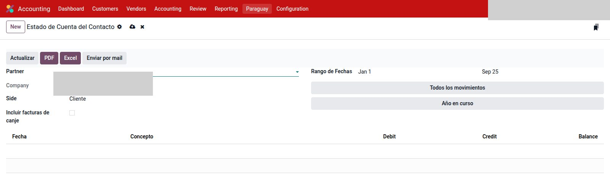

# Estado de cuenta del contacto

Módulo `account_partner_statement` (localization-common).

Cuenta corriente por **moneda del comprobante**, separando lado Cliente y Proveedor.

---

## Dónde está

- Menú **Contabilidad → Informes → Partners → Estado de Cuenta del Contacto**
- En la ficha del contacto: botón **Estado de cuenta**

---

## Uso

1. Elegí partner, compañía, lado (Cliente / Proveedor) y rango de fechas.
2. **Actualizar** arma el listado (saldo inicial + movimientos del período).
3. **PDF** / **Excel** / **Enviar por mail** usan el mismo contenido.

Columnas:

| Columna | Contenido |
|--------|-----------|
| Fecha | Fecha del comprobante |
| Concepto | Factura o pago (enlace al documento) |
| Comprobantes | En filas de **pago**: facturas o bills conciliados (nativo). Varios en la misma celda, separados por coma; en pantalla cada uno es enlace |
| Debe / Haber / Saldo | Importes en la moneda del movimiento |

El PDF usa el **layout de reporte de la compañía** (logo, dirección y pie nativos). No hay un segundo logo en el cuerpo del informe.

---

## Incluir facturas de canje

Marcá **Incluir facturas de canje** para traer también el otro lado del partner (cliente↔proveedor).

Regla anti-duplicado (según conciliación nativa):

| Situación | Qué se lista |
|-----------|----------------|
| Canje **totalmente** conciliado con un pago **del mismo período** | Solo el **pago**; en Comprobantes, el link a esa factura |
| Canje sin pago, pago **fuera** del período, o canje **parcial** | Se lista la **factura** de canje (y el pago si cae en el período) |
| Nunca (canje 100 % pagado + pago en el período) | Pago y la misma factura de canje como dos líneas |

## Notas

- Pagos sin conciliación dejan **Comprobantes** vacío.
