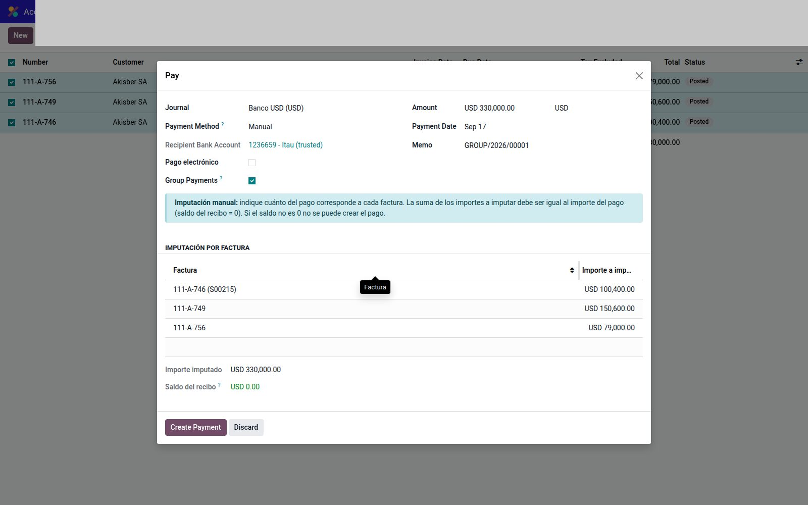
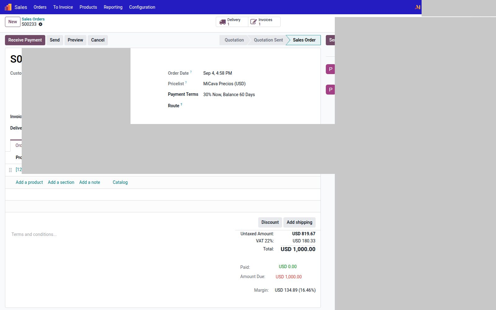

# Pagos: imputación y anticipos

| Módulo | Dónde | Qué hace |
|--------|--------|----------|
| `account_payment_register_allocation` | Wizard **Registrar pago** y pestaña del pago | Partir el pago entre facturas a mano, y dejar el histórico en el pago |
| `account_payment_allocation_approvals` | Pago saliente + app **Aprobaciones** | Exige solicitud Approvals aprobada antes de **Confirmar** (configurable por compañía) |
| `sale_payment_advance` | Pedido de venta | Cobrar una seña y conciliarla |

Los caminos de imputación conviven. La aprobación es un gate opcional encima del pago saliente; no cambia la imputación.

---

## Imputación desde el pago

En **Clientes → Pagos** o **Proveedores → Pagos**, pago nuevo, en borrador:

1. Elegí el contacto. La pestaña **Asignación de facturas** lista las facturas abiertas de la compañía del pago.
2. Completá **Importe a imputar** (única columna editable de importe), siempre en la **moneda del pago**. El resto es informativo: adeudado de la factura, equivale en moneda de la factura y **saldo factura** que queda. Con el menú de columnas de la grilla podés mostrar u ocultar las informativas.
3. El **TC** (unidades de moneda del pago por 1 de moneda factura, ej. pesos por 1 dólar) viene precargado y se puede editar. Misma moneda = 1. Si cambiás **moneda** del pago se regeneran las líneas; si cambiás **fecha o diario**, se recalcula el TC y se conservan los importes. **100%** cubre todo el adeudo de esa factura.
4. Si la suma imputada es menor que el pago, al confirmar aparece el aviso de saldo ≠ 0 con el botón **Dejar saldo a favor** (cliente o proveedor). Si imputás de más, se bloquea. Si dejás todo en 0, el pago se confirma sin conciliar.
5. Con el **tacho** sacás facturas que no van en este pago.
6. Confirmado, la pestaña queda solo lectura.

Cobro de cliente lista facturas de cliente. Pago a proveedor lista facturas de proveedor.

**Restablecer a borrador** deshace esa conciliación y vuelve a cargar las abiertas. **Cancelar** borra ese histórico.

---

## Imputación desde el wizard

Cuando registrás un pago **agrupado** de **2 o más** facturas:

1. Seleccioná las facturas → **Registrar pago** → marcar **Agrupar pagos**.
2. Aparece **Imputación por factura**: factura, **TC** editable e importe a imputar por línea.
3. **Importe imputado** y **Saldo del recibo**. Si sobra, marcá **Dejar saldo a favor**. Si imputás de más, no confirma.
4. Al crear el pago, la pestaña **Asignación de facturas** del pago muestra lo mismo.

Si no agrupás, o hay una sola factura, el bloque del wizard no se muestra. El pago igual guarda en la pestaña qué factura se concilió y por cuánto.

---

## Aprobación de pagos salientes

Requiere Enterprise **Approvals** y el módulo `account_payment_allocation_approvals`.

1. **Ajustes → Contabilidad → Aprobación de pagos**: activar **Aprobar pagos salientes**, elegir categoría (default *Pago a proveedor*) y monto mínimo (`0` = todos los salientes, incluidos importes chicos; usá un valor > 0 para limitar).
2. En **Aprobaciones → Configuración → Categorías**, poné al menos un aprobador **distinto** de quien registra el pago (CFO / tesorería). Si el único aprobador sos vos, el envío se bloquea.
3. En un pago **saliente** en borrador: botón **Enviar a aprobación**. Arma sola la solicitud Approvals con contacto, monto, diario y facturas imputadas, la envía a los aprobadores y te deja en el pago. El smart button **Aprobación** abre la solicitud si querés verla.
4. El aprobador acepta en **Aprobaciones** (actividad / mail con link a Odoo).
5. Vuelve al pago → **Confirmar**. Si cambiás monto, contacto, moneda, fecha, **diario** o la **imputación**, se anula la solicitud y hay que enviar de nuevo.

Los cobros (inbound) no pasan por este gate.

---

## Anticipo desde el pedido

En un pedido **confirmado** con saldo:

1. Botón **Receive Payment** (seña).
2. Importe, diario, fecha. Confirmar.
3. El pedido muestra **Paid** / **Amount Due** y la pestaña **Entregas de dinero**.
4. Al facturar, esa seña se concilia.

Varios anticipos parciales sobre el mismo pedido están permitidos.
