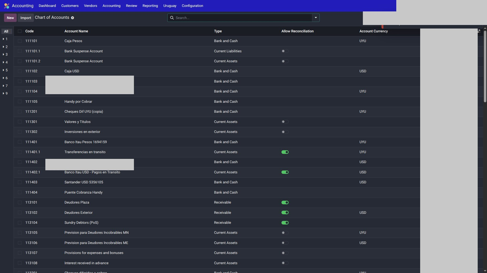
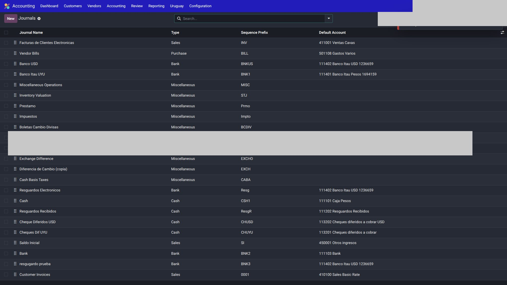
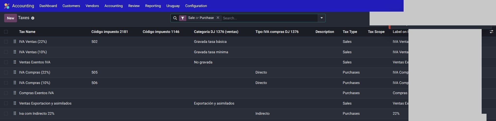

# Cuentas, diarios e impuestos — Uruguay

La localización no reemplaza el plan de cuentas nativo de Odoo: lo **usa**. Cada compañía tiene el suyo.

!!! warning
    No copies el plan, los códigos ni los diarios de otra empresa. Instalás el chart Uruguay y lo afinás con el contador de **esa** compañía.

---

## Plan de cuentas

1. Con la compañía activa: instalar / verificar el plan Uruguay (localización + Accounting).
2. `Contabilidad → Configuración → Plan de cuentas`.

    

3. Revisar cuentas de clientes, proveedores, IVA débito/crédito, redondeo y diferencia de cambio.

Los reportes DGI leen **líneas de impuesto** y cuentas de IVA/IRPF, no “el diario mágico”. Un M2M de “diarios para reportes”, si existe, es **filtro opcional**: vacío = todos.

---

## Diarios

`Contabilidad → Configuración → Diarios`.

| Tipo | Para qué en UY |
|------|----------------|
| Ventas | Emite CFE. Debe tener tipo de documento DGI y punto de emisión. |
| Compras | Facturas proveedor / CFE recibidos. Diario específico para recibidos si la compañía lo define. |
| Banco / caja | Pagos nativos. No mezclar con diarios de un cliente (p. ej. cobranzas bancarias propias). Los métodos de [cheques](cheques.md) se habilitan acá (banco para propios, efectivo de cartera para terceros). |
| Varios | Ajustes, diferencia de cambio, asientos de impuesto a mano. |

Checklist por diario de **ventas**:

1. Compañía correcta (multi-empresa).
2. Tipo de documento CFE (e-Factura, e-Ticket, …).
3. Punto de emisión DGI.
4. Secuencia: la fiscal la gobierna CFE; no pelees con un número manual.

En la compañía podés setear el **diario para comprobantes recibidos** (compras).

---

## Impuestos

`Contabilidad → Configuración → Impuestos`.

1. IVA tasas vigentes del plan Uruguay.
2. Cuentas de débito y crédito fiscal coherentes con el CoA de **esta** compañía.
3. Posiciones fiscales si hay exportación / no gravado.
4. Retenciones / IRPF solo si el circuito de esa empresa las usa.
5. **Tipo IVA compras DJ 1376** (Directo / Indirecto) en cada impuesto de **compra**, y el mismo tax en el **producto**. Ver [abajo](#tipo-iva-compras).

!!! tip
    En la factura, el impuesto de la línea es el que viaja al CFE y el que después sale en reportes DGI. Si el tax está mal mapeado, el XML y el 2181/1146 van a mentir.

---

## Tipo IVA compras (Directo / Indirecto) {#tipo-iva-compras}

Campo **Tipo IVA compras DJ 1376** en el impuesto, y **Categoría DJ 1376 (compras directas)** en la **cuenta** de gasto (solo si el tax es Directo).

Norma: [Art. 14 Título 10 TO 2023](https://www.impo.com.uy/bases/todgi2023/101-2024/14_T10) (Dec. 101/024) y FAQ DGI del 18/06/2024 (cita también Art. 124 Dec. 220/998).

| En Odoo | Criterio DGI | Ejemplos de producto |
|---------|--------------|----------------------|
| **Directo** | El bien o servicio se destina **exclusivamente** a una operación. El IVA se deduce entero (gravada) o no se deduce (exenta). No se prorratea. | Almacenaje de mercadería nacionalizada / gravada |
| **Indirecto** | **No** es exclusivo de gravadas ni de exentas. Se deduce en **proporción a las ventas gravadas** del ejercicio. | Telefonía, internet, energía, GAV de administración |
| Cuenta **IVA importación** (Ajustes 1376) | Apartado **B** del Art. 14: IVA pagado al importar. No usa este campo. **No** va a IVA perdido. | Despacho / aduana |
| Categoría **exportación** (cuenta o % de ventas) | El Art. 14 **permite deducir** (y, si hay crédito, devolver o imputar) el IVA que integra el costo del producto exportado. **No** es gasto de IVA perdido. | — |

**Cómo cargarlo**

1. Creá (o usá) dos impuestos de compra por alícuota, p. ej. *IVA Compras 22 %* = Directo y *IVA compras indirecto 22 %* = Indirecto. Lo mismo a tasa mínima.
2. En cada **producto** de compra, impuestos de proveedor = el que corresponda. El motor lee el tax de la factura, no el nombre del producto.
3. En cuentas de gasto usadas con tax **Directo**, cargá **Categoría DJ 1376 (compras directas)** (`gravada` por defecto). Ahí se decide si ese IVA es 100 % crédito o queda fuera del deducible. Si una misma factura junta cuentas de categorías distintas bajo ese tax, el 1376 **no calcula**: el Art. 14 no reparte un IVA directo. Separá las líneas.
4. La cuenta de **IVA importación** se tipa en Ajustes (compañía), no en el tax.

Si un gasto común (telefonía, GAV) lleva tax **Directo**, el 1376 lo toma como exclusivo y **no** lo prorratea: el IVA perdido del mes queda corto y el crédito IVA queda inflado. Corregí el tax del producto y volvé a calcular.

**IVA perdido** (gasto al calcular el 1376) = tajada de IVA **indirecto** del mes asignada a ventas no gravadas / IVA en suspenso / impuesto percibido. No incluye directo, importación ni exportación. El asiento a la cuenta de IVA perdido **no** se postea al calcular: sale en borrador con **Generar boleto y asientos**, después de que un humano aprueba la DJ.

---

## Redondeo y tipo de cambio

- **Redondeo en la venta:** flag en la compañía si aplica la política de redondeo comercial.
- **TC en facturas de proveedor:** flag para mostrar el tipo de cambio en compras.
- **Diferencia de cambio:** [módulo UY](diferencia-cambio.md); cuentas y diarios **por compañía**.

---

## Véase también

- [Configuración CFE](configuracion.md)
- [Uso](uso.md)
- [Reportes DGI](reportes.md)
- [Diferencia de cambio](diferencia-cambio.md)
