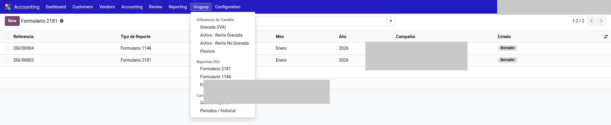
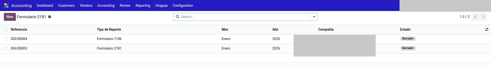
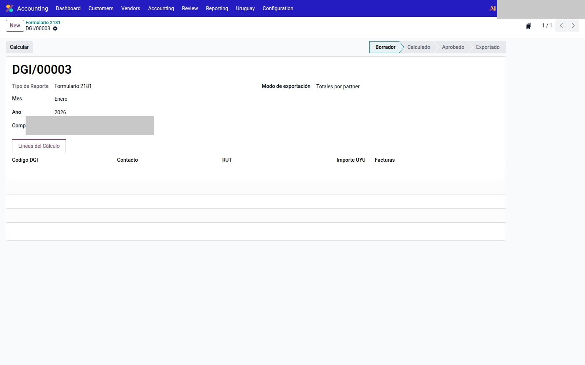
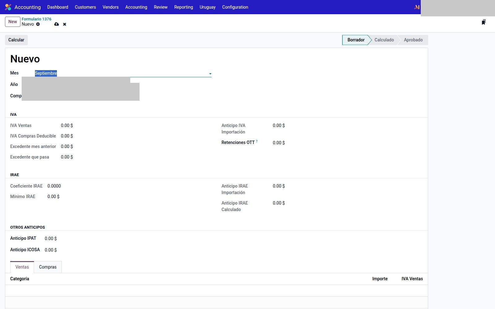

# Reportes e Impuestos DGI

Módulo `l10n_uy_tax_reports`. Camino operativo bajo `Contabilidad → Uruguay → Impuestos`:

| Menú | Para qué |
|------|----------|
| **Liquidación Mensual y Boleto de Pago** | **Camino principal 1376:** liquidadores → DJ → boleto → asientos (diario de impuestos) → candado; **TXT DGI** arma el 2181 |
| **Tablero del ejercicio** | **Resumen fiscal del año:** una fila por mes (ventas, IVA, excedente, anticipos, OTT, IVA perdido, IVA DC gravada, DC activo/pasivos, IRPF 1146, boleto). El pie suma el ejercicio. Exportar Excel nativo. El mayor por cuenta es el **Balance de comprobación** |
| **Liquidadores** | Detalle por impuesto (debug / revisión); aprobar exige grupo Aprobador |
| **Formularios DGI** | Packs **1146 / 1144 / 2183 / 1050** (mismo flujo que la liquidación). **2181** es consulta del TXT ya calculado; no se crea ni se calcula ahí |

Los ítems se muestran según los tildes de **Impuestos UY** en la compañía.

El **1376** se arma desde el pack; el detalle del IVA se mira en **Liquidadores → IVA**.

El filtro de diarios en Ajustes es **opcional**: vacío = todos. Si se carga, acota **TXT y 1376** a esos diarios (el IVA de **DC gravada** se lee igual, aunque el diario EXCH no esté en la lista). La liquidación sigue dependiendo del mapeo de cuentas e impuestos. Corré **Diferencia de cambio → Gravada (IVA)** (solo ventas) y posteá el asiento **antes** de calcular el 1376 / 2181 del mes. Si hay IVA Art. 111, configurá la **cuenta IVA de la diferencia** antes de **Generar boleto y asientos**.

---

## Antes de calcular

En `Contabilidad → Configuración → Ajustes` (compañía fiscal Uruguay), bloque **Impuestos UY** (también pestaña en la ficha de la compañía):

1. Qué impuestos habilitar (IVA, IRAE, Patrimonio/IPAT, …).
2. **Diarios para Reportes DGI** — filtro opcional (vacío = todos). Aplica a **TXT y DJ 1376** por igual.
3. Cuentas y parámetros de liquidación: diario de cierre, DGI a pagar, IVA/excedente/OTT, anticipos IRAE/IP/ICOSA, IRPF, importación. Sin diario de cierre no se pueden generar asientos desde **Liquidación del mes**.
4. Si **no hay pack 1050 cerrado**, Ajustes y la ficha de compañía muestran un aviso: cargá a mano el **% / coeficiente de anticipo IRAE (renta)** y el de **Patrimonio / IPAT**. La **IRAE anual** se confecciona en **PADI**; un 1376 cerrado o un lock date no la sustituyen.

**Patrimonio (IPAT)** es una sola familia fiscal, no dos impuestos distintos:

| Dónde | Qué |
|-------|-----|
| Ajustes / compañía | Un bloque: anticipo **mensual** (1376/boleto) + determinación **anual** + DJ **1050** |
| Liquidadores → **Patrimonio (IPAT)** | Submenú **Anticipo mensual** / **Determinación anual** |
| Formularios DGI → **1050 — Patrimonio anual** | Pack de **propuestas** al hub (coef/mín IRAE, IPAT, ICOSA). Exige determinación Patrimonio aprobada. **No** liquida IRAE anual ni arma el boleto 1050: eso es PADI. |

**Crédito / excedente IVA inicial (cutover):** en Impuestos UY cargá el L21 de arranque (semilla). Se usa **solo** si no hay DJ 1376 del mes anterior **aprobada**; después manda la cadena mes a mes. No es el saldo eterno de la cuenta 114310 (esa puede servir de control, no de dueña del número).

En el liquidador **IVA** y en la liquidación del mes se muestra **Saldo IVA a favor**. Si no hay IVA a pagar, en **Boletos** queda una línea informativa `IVA: $0 — crédito a favor …` (sin exigir nº/PDF de boleto).

En cada impuesto (`Contabilidad → Configuración → Impuestos`):

| Campo | Para qué |
|-------|----------|
| Línea 2181 | Agrupa el tax en el 2181 |
| Línea 2183 | Agrupa el tax en el 2183 (agente) |
| Línea 1146 | Agrupa el tax en el 1146 |
| Línea 1144 | Agrupa el tax en el 1144 (dependientes / IRPF tipado) |
| Categoría DJ 1376 (venta) | Clasifica ventas de la liquidación |
| Tipo IVA compras 1376 | **Directo** o **Indirecto** (Art. 14). Definí el tax y asignalo al producto de compra. Detalle en [Cuentas e impuestos](cuentas.md#tipo-iva-compras) |

Si el tax no está mapeado, el XML CFE puede estar bien y el reporte igual sale incompleto.

---

## Liquidadores (detalle por impuesto)

`Contabilidad → Uruguay → Impuestos → Liquidadores → …`

Ahí se calcula y aprueba cada impuesto del mes (montos a pagar / crédito). Es el lugar del **detalle de liquidación** (p. ej. IVA), no el armado del boleto.

En el liquidador **IVA**, los botones **Créditos** / **Egresos** abren la lista nativa agrupada por categoría (Grouped Tree: No gravada, Gravada, … con facturas debajo). **Saldo** resume totales. En el **2181**, el detalle de facturas está en el smart button **Detalles** y en **Ver facturas** por línea. En **1146**, **Ver agrupado por código DGI**. En la liquidación del mes, **Generar boleto y asientos** queda disponible para usuarios Impuestos UY.

Desde **Liquidación Mensual y Boleto de Pago**, en cada línea del pack usá **Abrir** para ir al liquidador y validarlo. El aviso azul indica el próximo paso. Con la DJ lista, **Generar boleto y asientos** arma las líneas de pago y los asientos. **Publicá** esos asientos. En cada línea cargá el **nº de boleto DGI**, el **PDF del boleto DGI** y, si aplica, el **comprobante bancario**. **Cerrar / conciliar** exige asientos publicados + nº + PDF DGI; no se cierra solo con boletos.

En el asiento **IVA**, *DGI a pagar* es el monto del boleto (línea 545). Si hay crédito y el boleto IVA es $0, esa cuenta queda en cero; lo que no cierra de compras/IVA importación va a **excedente IVA**, no se inventa un a pagar. El crédito **OTT** (cuenta 114311, sin diferencia de cambio ni asiento de cierre) se aplica al boleto como en Rubro 7: primero **ICOSA**, el resto **IRAE**. No baja el IVA. El sobrante queda en 114311. El haber de 114311 en el asiento de cierre lleva el **mismo contacto** que el debe del mes (para conciliar resguardo Handy). Un **crédito IPAT** extra (p. ej. remanente de anticipo IVA importación) se carga a mano en la DJ; no se inventa. El **anticipo IRAE importación** (cuenta 114205) se revierte en el asiento **IRAE**, no en el IVA. El certificado de crédito DGI no se revierte solo: si aplica, el asiento va a mano. IRAE, IPAT e ICOSA sí van a DGI a pagar por el monto del boleto (ICOSA/IRAE ya netos de OTT). El pack copia el anticipo IRAE/ICOSA **bruto** a la DJ al marcarla lista.

**TXT para PADI:** cada pack tiene su botón **TXT DGI (PADI)**. El 1376 no arrastra el 1146.

| Pack / form | Código TXT | Notas |
|-------------|------------|--------|
| 1376 → 2181 | `02181` | Solo IVA ventas/compras |
| 1146 | `01146` | Pack aparte: asiento IRPF (p. ej. 213306) ↔ DGI a pagar, diario de impuestos. Cuenta IRPF **y/o** e-Resguardos 1146 |
| 2183 | `02183` | Pack aparte. Taxes **Código impuesto 2183** **y/o** e-Resguardos 2183 |
| 1144 | `01144` | Pack aparte. Cuenta IRPF **y/o** e-Resguardos 1144 (CI/NIE/PAS/DNI) |

Los **e-Resguardos emitidos con CFE** aportan las líneas de la pestaña **Retenciones** (código + importe) a 1146/1144/2183. Los **recibidos** no entran a esos formularios (ahí la empresa es agente). No se cuentan dos veces si el mismo pago también genera asiento en la cuenta IRPF; el filtro de diarios del hub no aplica a este puente.

Si faltan aprobar, abre esos formularios; si ya están aprobados, descarga el `.txt` (o un `.zip`) y lo deja en el chatter. El **1376** y el **1050** no tienen TXT de importación usable desde Odoo: se confeccionan en PADI. El archivo TXT termina en `;` (requisito del instructivo DGI).

**Aprobar / exportar TXT:** hace falta el grupo **Impuestos UY / Aprobador** (o administrador contable) — liquidadores, pack, formularios TXT y sincronización de la DJ. El usuario de impuestos puede calcular y armar boleto, pero no aprobar ni exportar PADI.

---

## 2181 y 1146

Un camino: el **pack**. El 2181 se arma con **TXT DGI (PADI)** en la liquidación 1376. El 1146 es un pack propio (`Formularios DGI → 1146`) con boleto y asiento en el diario de impuestos, no mezclado con el IVA.

`Formularios DGI → 2181` es **consulta** de TXT ya calculados (sin «Nuevo»).

Desde el pack:

1. **TXT DGI (PADI)** calcula el formulario del mes.
2. Revisá líneas (partner, RUT, importe). **Ver detalle** abre las facturas.
3. **Aprobar** (grupo Aprobador).
4. **Exportar TXT** (mismo grupo). El archivo queda en el formulario y en el chatter del pack.

Estados: Borrador → Calculado → Aprobado → Exportado. **Volver a Borrador** si hay que recalcular (desde el TXT abierto por el pack).

### Cómo arma el 2181 (reglas DGI)

El código de línea del impuesto (`Línea 2181`) es el punto de partida; el reporte **reclasifica** según el contacto:

| Situación | Línea DGI | Importe |
|-----------|-----------|---------|
| IVA ventas a **contribuyente** (RUT Uruguay válido) | **502** / **503** | IVA |
| Ventas a **no contribuyente** (CI u otro doc.) | **501** | Base imponible (ventas) |
| IVA compras plaza (directo e indirecto, si el tax está mapeado) | **505** / **506** | IVA |
| IVA importación (cuenta de Ajustes del 1376) | **1** | IVA |
| RUT estructuralmente inválido (p. ej. bloque `22…`) o sin identificación | **Exclusiones** | No va al TXT |

- Instructivo GC/CEDE: el **502/503** es IVA ventas **a contribuyentes**; no se detallan consumidores finales ahí.
- La pestaña **Exclusiones** lista lo que PADI rechazaría o no se puede informar; corregí el RUT en la ficha y volvé a calcular.
- **505/506 plaza:** además del campo Línea 2181, entran solos los impuestos de compra con **Tipo IVA compras DJ 1376** directo/indirecto (22 % → 505, 10 % → 506). El 1376 sigue usando ese tipo para el prorrateo.
- **IVA diferencia de cambio gravada** (asiento EXCH, flag en la línea, solo cobranzas): si la factura mezcla 10 % y 22 %, el IVA Art. 111 se **parte** en **503** y **502** según el IVA de esa factura. Una sola alícuota (o sin factura origen) usa la tasa más cercana a 10 % o 22 %. **501** si el partner no es contribuyente (la base usa la tasa efectiva de esa factura). No hace falta `tax_line_id`. Las compras con el mismo flag no entran al 1376 ni al 2181.
- Importes de **ventas** (501/502/503) se guardan en positivo (como la DJ); las NC quedan negativas. El TXT **trunca** los decimales (no redondea). PADI admite ambos signos. En el 1376, si en un rubro las NC superan a las facturas, el neto de ese rubro queda negativo.
- La línea **1** (importación) usa la misma cuenta de IVA importación del bloque DJ 1376 en Ajustes.

El 1146 usa el mismo circuito (sin esas reclasificaciones del 2181).

No se publica el TXT ni el RUT de la compañía.

---

## 1376 — DJ mensual IVA · IRAE · IP · ICOSA

`Contabilidad → Uruguay → Impuestos → Formularios DGI → 1376 — DJ mensual IVA · IRAE · IP · ICOSA`.

Declaración jurada mensual DGI (CEDE/GC): paneles de IVA, anticipos de IRAE, IP e ICOSA. Agrupa varios liquidadores. El **boleto y los asientos de cierre** se arman en **Liquidación del mes** (un solo camino operativo).

1. **Nuevo.** Mes, año, compañía (o trabajar desde liquidadores + liquidación del mes).
2. **Calcular.** Completa IVA ventas, compras deducibles, excedente, anticipos e IRAE.
3. Revisá pestañas **Ventas** y **Compras**. **IVA perdido** se completa al calcular (tajada de IVA **indirecto** a no gravada / suspenso / percibido; afuera exportación e IVA importación). Revisalo; se puede ajustar hasta aprobar. Completá a mano `Retenciones OTT`, `IPAT` e `ICOSA` si aplica. El asiento de IVA perdido **no** nace al calcular: hace falta **Generar boleto y asientos**.
4. **Aprobar.**
5. Ir a **Liquidación Mensual y Boleto de Pago** → **Generar boleto y asientos** → cargar nº DGI + PDF(s) → **Cerrar / conciliar**.

El comprobante de pago bancario se adjunta en la misma línea del boleto (además del PDF DGI).

**Tablero del ejercicio:** `Contabilidad → Uruguay → Impuestos → Tablero del ejercicio`. Resumen del año (filtro *Ejercicio actual*): una fila por mes, pie = acumulado. Clic abre el pack. Incluye IVA perdido, IVA de DC gravada e IRPF 1146 del mismo mes; las columnas de revalúo DC (activo gravado / no gravado / pasivos) son informativas para PADI. Ventas = neto/base (22 % vs 0 %); el % gravada YTD incluye también tasa mínima. El mayor cuenta × mes es el Balance de comprobación, no este tablero.

---

## Véase también

- [Diferencia de cambio](diferencia-cambio.md)
- [Cuentas e impuestos](cuentas.md)
- [Uso](uso.md)
